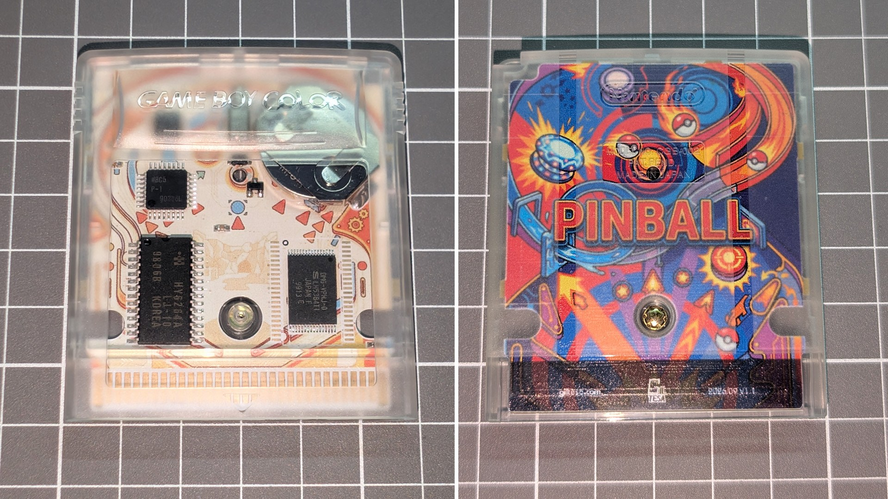

# Pokémon Pinball for Game Boy: Custom Motherboard

This is a **full-color printed custom motherboard** for the game **Pokémon Pinball** for Game Boy. You can use it to customize your original Pokémon Pinball, whose battery has long since died or whose original PCB has become damaged or corroded.

Additionally, as you can see in the photos, this new circuit will give an incredible look to your Pokémon Pinball. Pair it with a transparent Game Boy or Game Boy Color shell to show off the artwork

## Notes

*   The board is compatible with two different ROM chip sizes. The photos show the **MX23C1603-12A** ROM, with **44 pins** in total, 22 on each side. It is also compatible with the **MX23C8006-12** ROM, with **32 pins** in total, 16 on each side.

## Would you like it?

[**Pokémon Pinball for Game Boy: Custom Motherboard**](https://shop.giltesa.com/?p=7909)

## License

This project is licensed under a **Creative Commons** license:
**[Attribution-NonCommercial-ShareAlike 4.0 International (CC BY-NC-SA 4.0) ](https://creativecommons.org/licenses/by-nc-sa/4.0/)**

Check the [LICENSE.md](LICENSE.md) for more information.
